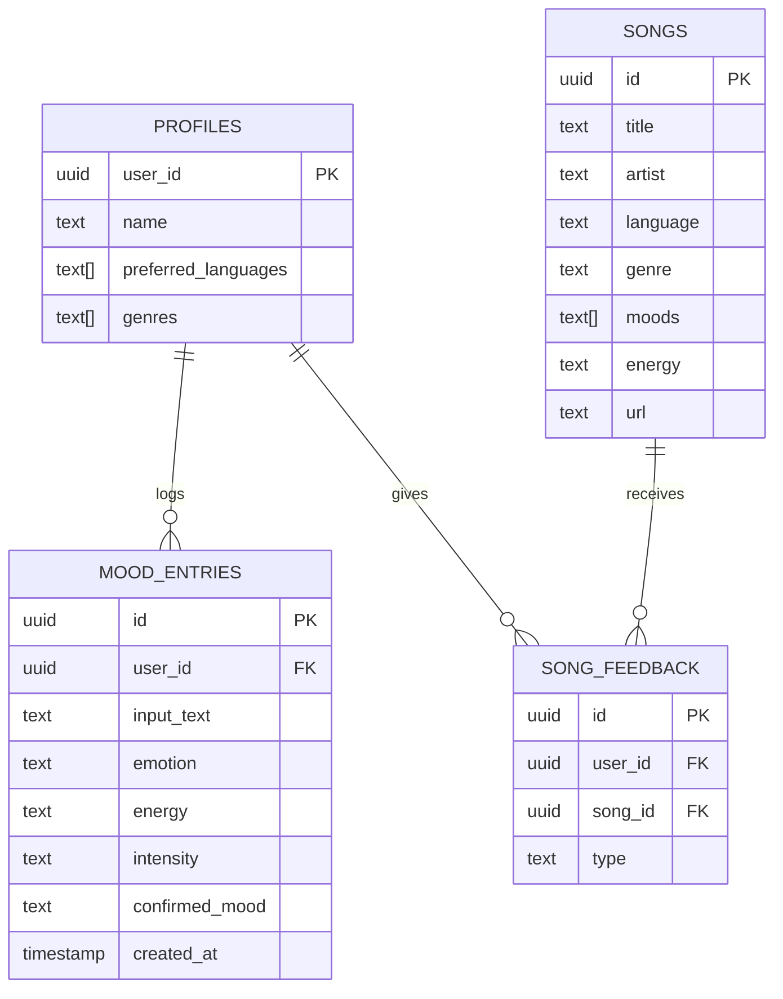
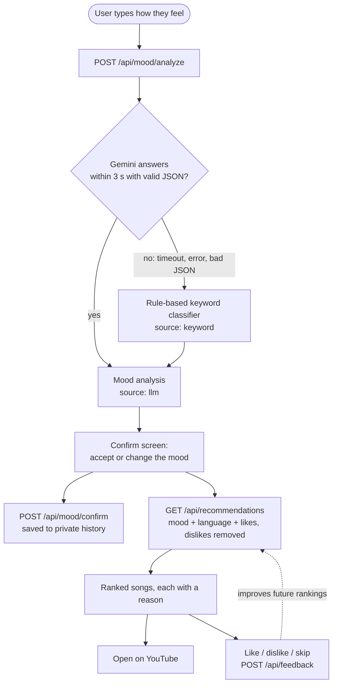

# Moodify

> **Feel it. Express it. Play it.**
> Type how you feel in English, Hindi or Hinglish, and get a ranked list of Hindi and English songs that fit, in under 10 seconds.

[](https://github.com/Aj1359/Moodify/actions/workflows/ci.yml)
[](LICENSE)
[](https://nodejs.org/)
[](https://expo.dev/)
[](https://supabase.com/)
[](https://ai.google.dev/)

Mood playlists usually make you pick from a fixed menu of tags. Moodify lets you say it in your own words, the way you would text a friend: *"aaj office me bohot burnout ho gaya, need something chill"*. It works out the mood, lets you correct it, and recommends songs that match your mood, language and taste.

## Highlights

- **Three ways of writing:** English, Hindi in Devanagari, and Romanised Hinglish, including code-mixed text, slang, typos and emojis.
- **Two-stage NLP pipeline:** Gemini in JSON mode with few-shot prompting, backed by a rule-based multilingual classifier that answers in under 1 ms when the LLM is slow or unavailable.
- **You stay in control:** the app shows the detected mood and lets you change it before picking songs.
- **Personal ranking:** songs from a curated 120-song Hindi and English catalog, scored on mood, language and what you have liked. Disliked songs never come back.
- **Private history:** weekly mood counts, and you can delete one entry or all of them.
- **Measured, not guessed:** a 144-sentence trilingual benchmark with accuracy, macro-F1 and a confusion matrix.

## Contents

- [Architecture](#architecture)
- [How it works](#how-it-works)
- [Quick start](#quick-start)
- [The NLP pipeline](#the-nlp-pipeline)
- [Evaluation](#evaluation)
- [Recommendations](#recommendations)
- [API](#api)
- [Testing](#testing)
- [Project status](#project-status)
- [Team](#team)
- [Contributing](#contributing)

## Architecture

| Layer | Technology |
| --- | --- |
| Mobile app | React Native 0.74, Expo SDK 51, Expo Router, TypeScript (strict) |
| Backend | Node.js 22+, Express 4 |
| Database and auth | Supabase: Postgres, Auth, row-level security |
| NLP | Gemini (JSON mode) with a rule-based multilingual fallback |
| Playback | External YouTube links |

```text
Moodify/
├── backend/
│   ├── src/
│   │   ├── app.js                    Express app, routes, JSON 404 and error handler
│   │   ├── server.js                 Starts the app on PORT
│   │   ├── config/                   Supabase clients, shared contract constants
│   │   ├── controllers/              Mood, preferences, recommendation and feedback handlers
│   │   ├── middlewares/              Auth (Supabase JWT), request validation, errors
│   │   ├── routes/                   /api/mood, /api/preferences, /api/recommendations, /api/feedback
│   │   ├── services/                 Gemini emotion service, quota guard (llmGuard.js), keyword
│   │   │                             classifier, prompt examples, recommendation engine
│   │   ├── utils/                    mappers.js (the only snake_case <-> camelCase layer), scoring.js
│   │   └── data/                     Song catalog, fallback pool, mood lexicon
│   ├── scripts/                      evaluate.js (benchmark report), seedSongs.js, checkSongLinks.js
│   │                                 (npm run links), demoRecommendations.js, assignSongIds.js
│   └── tests/                        Unit and HTTP tests, benchmark, evaluation toolkit
├── mobile/
│   ├── app/                          Screens (Expo Router): (auth), (tabs), recommendations
│   ├── assets/                       App icon, adaptive icon, splash, favicon
│   ├── eas.json                      Android build profiles (preview APK, offline demo APK)
│   └── src/
│       ├── components/               SongCard, MoodChip, FeedbackButtons, pickers
│       ├── context/AuthContext.tsx   Session and onboarding state
│       ├── hooks/                    useMood, useRecommendations
│       ├── services/                 API client, Supabase client, mock backend
│       └── types/index.ts            Shared request and response types
├── .github/workflows/ci.yml          Tests and type check on every pull request
├── supabase/
│   ├── migrations/                   Database schema, row-level security, indexes
│   └── seed_songs.sql                The 120-song catalog as plain SQL
├── render.yaml                       Render blueprint for the backend
└── docs/                             API contract, evaluation, deployment guide, test plan
```

**App screens:** Login, Sign up and Onboarding (languages and genres); then Home (mood chips, recent entries), Mood AI (type a feeling, confirm the mood), Recommendations, My Music (liked songs), My Mood (weekly counts, history, delete) and Profile.

### Data model



Row-level security keeps every user's mood entries and feedback private. The backend uses the service role, so it also filters every query by the logged-in user.

## How it works



A failed LLM call never surfaces as an error: the keyword classifier returns the same JSON shape, so the app behaves the same either way.

## Quick start

You need **Node.js 22+** (the Supabase client uses its built-in WebSocket) and the **Expo Go** app on your phone, or an Android or iOS simulator.

### Option A: run the app on mock data (no backend, no keys)

The fastest way to see the app. A built-in mock backend answers every endpoint with realistic data, and login accepts any email and password.

```bash
cd mobile
npm install
cp .env.example .env        # then set EXPO_PUBLIC_USE_MOCKS=true
npx expo start              # press a (Android), i (iOS), or scan the QR code with Expo Go
```

In mock mode, put `#error` in your mood text to simulate a server error, or `#fallback` to see a keyword-fallback answer.

### Option B: run the full stack

The short version is below. For deployment (Render backend, Android APK) and a demo-day checklist, follow **[docs/deployment.md](docs/deployment.md)**.

**1. Database (Supabase)**

1. Create a free project at [supabase.com](https://supabase.com).
2. Open **SQL Editor** and run each file in [`supabase/migrations/`](supabase/migrations) in name order (schema first, then the history index).
3. Check that the tables `profiles`, `songs`, `mood_entries` and `song_feedback` exist.

To run Supabase locally in Docker instead, use `npx supabase start` from the repo root. It applies the same migration.

**2. Backend**

```bash
cd backend
npm install
cp .env.example .env        # fill in the values below
npm run seed                # load the 120-song catalog into Supabase (safe to re-run)
npm run dev                 # http://localhost:5000/health should return {"status":"ok"}
```

Without Supabase credentials, `/api/recommendations` still answers from the built-in 20-song fallback pool. Try it with `node scripts/demoRecommendations.js`.

**3. Mobile app**

```bash
cd mobile
npm install
cp .env.example .env        # fill in the values below, EXPO_PUBLIC_USE_MOCKS=false
npx expo start
```

**Environment variables**

| Variable | File | What it is |
| --- | --- | --- |
| `SUPABASE_URL` | `backend/.env` | Project URL, from Supabase → Project Settings → API |
| `SUPABASE_SERVICE_ROLE_KEY` | `backend/.env` | Service role key. Secret: backend only, never in the app |
| `SUPABASE_ANON_KEY` | `backend/.env` | Public anon key, used to verify user tokens |
| `LLM_API_KEY` | `backend/.env` | Gemini key from [Google AI Studio](https://aistudio.google.com/app/apikey). Without it, every request uses the keyword classifier |
| `LLM_MODEL` | `backend/.env` | Gemini model id. Default and recommended: `gemini-3.5-flash-lite` (free tier: 500 requests a day; `gemini-2.5-flash` allows only 20) |
| `LLM_DAILY_LIMIT`, `LLM_USER_PER_MINUTE` | `backend/.env` | Quota guard, default 450 a day and 10 per user per minute. Over a limit the keyword fallback answers |
| `CORS_ORIGINS` | `backend/.env` | Comma-separated origins allowed for the web build. Empty allows all; the phone app is not affected |
| `EXPO_PUBLIC_SUPABASE_URL` | `mobile/.env` | Same project URL |
| `EXPO_PUBLIC_SUPABASE_ANON_KEY` | `mobile/.env` | Public anon key. The app never gets the service role key |
| `EXPO_PUBLIC_API_BASE_URL` | `mobile/.env` | `http://localhost:5000/api` on a simulator; `http://<your laptop's LAN IP>:5000/api` on a phone |
| `EXPO_PUBLIC_USE_MOCKS` | `mobile/.env` | `true` for the mock backend, `false` for the real one |

`.env` files are gitignored. Never commit real keys.

## The NLP pipeline

### Mood taxonomy

Every input is mapped to one to three of eight moods, strongest first.

| Mood | | Music energy | Typical situations |
| :--- | :---: | :---: | :--- |
| **Happy** | 😊 | High | Celebrations, good news, wanting to dance |
| **Sad** | 🌧️ | Low | Heartbreak, loneliness, grief, feeling low |
| **Angry** | 🔥 | High | Frustration, feeling wronged, venting |
| **Stressed** | 🤯 | Medium | Exams, deadlines, interviews, overwhelm |
| **Relaxed** | 🌿 | Low | Unwinding, tiredness, rainy days, sleep |
| **Motivated** | ⚡ | High | Workouts, study sessions, hustle |
| **Romantic** | 💖 | Medium | Dates, crushes, partners |
| **Nostalgic** | 📻 | Medium | Childhood, old friends, old songs |

The analysis returns a structured object:

```json
{
  "emotion": "exhaustion",
  "energy": "low",
  "intensity": "high",
  "context": "work",
  "targetMoods": ["Relaxed", "Stressed"],
  "source": "llm"
}
```

### Stage 1: LLM (`backend/src/services/emotionService.js`)

- **Model:** `gemini-3.5-flash-lite` by default (set `LLM_MODEL` to change it) through the Gemini REST API, in JSON output mode at temperature 0.1. Chosen for its free-tier quota and speed; see [Model choice](docs/evaluation.md#model-choice).
- **Prompt:** mood definitions, explicit rules (input may be in any of the three scripts; one to three moods, strongest first; exhaustion maps to Relaxed; joy about a person or a date is Romantic; losing interest in everything is Sad, not Relaxed), and 12 few-shot examples from [`promptExamples.js`](backend/src/services/promptExamples.js). The examples cover all eight moods, all three scripts and the hard cases: negation, mixed feelings, a music request with no feeling word, and longing.
- **Validation:** the reply is checked against the contract (allowed moods and levels, one to three moods, no duplicates); letter case and a stray ```` ```json ```` wrapper are tolerated. Anything else that fails goes to stage 2.
- **Timeout:** a hard 3-second deadline for the whole call, including reading the reply.

### Stage 2: rule-based fallback (`backend/src/services/keywordFallback.js`)

A deterministic classifier that never throws and answers in about 0.1 ms.

| Step | What it does |
| --- | --- |
| Normalisation | Unicode normalisation, Devanagari nukta removal (ख़ुशी = खुशी), lowercasing, apostrophe stripping; sentence punctuation and the danda become clause boundaries |
| Lexicon | 775 terms (316 English, 312 Hinglish, 147 Devanagari) in 10 emotion cue groups mapped onto the 8 moods, in [`moodLexicon.js`](backend/src/data/moodLexicon.js) |
| Matching | Longest phrase first; prefix terms (`frustrat*`); elongated words (`sooo`, `happyyy`); one intensifier allowed inside a phrase (`mann bilkul nahi lag raha`) |
| Negation | Clause-aware: English negators act forwards, Hindi and Hinglish negators on both sides; idioms such as "can't stop smiling" are not negation; negated cues are dropped or flipped (`khush nahi hu` → Sad) |
| Intensity | Intensifiers (`bahut`, `so`, `बहुत`), diminishers (`thoda`), repeated punctuation, elongation, repeated emojis |
| Extras | 61 emoji cues and 10 context categories (work, studies, relationship, family, fitness and more) |

## Evaluation

The benchmark in [`backend/tests/hinglish_eval.json`](backend/tests/hinglish_eval.json) has **144 labelled sentences**: 48 each in English, Hindi (Devanagari) and Hinglish, 6 per mood per language. They are written the way people actually text, and the prompt's few-shot examples are kept separate from them; a test enforces this.

| Engine | Top-1 accuracy | Macro-F1 | Latency | Target |
| --- | --- | --- | --- | --- |
| Keyword classifier alone | 71.5% | 0.754 | p95 < 3 ms | Never fails, < 50 ms |
| **Full pipeline (Gemini + fallback)** | **97.9%** | **0.979** | p95 1.5 s | **≥ 80%**, < 3 s ✅ |

| Language | Keyword classifier | Full pipeline |
| --- | --- | --- |
| English | 64.6% | 97.9% |
| Hindi (Devanagari) | 75.0% | 97.9% |
| Hinglish (Romanised) | 75.0% | 97.9% |

The LLM fixes 39 of the keyword classifier's 41 errors, mostly sentences with no mood word at all ("rent is due and my salary hasn't come yet"). Its own mistakes are close calls (Happy vs Romantic, Sad vs Nostalgic) with the right mood second. Across three runs, Gemini's own answers were right 98.8% of the time. When the keyword classifier finds a mood cue it is right 95.1% of the time, which keeps the fallback dependable when Gemini is down. Per-mood results, confusion matrices, error analyses and the model comparison are in [docs/evaluation.md](docs/evaluation.md).

```bash
cd backend
npm run eval                 # keyword classifier report
npm run eval -- --errors     # ... plus every misclassified sentence
npm run eval:llm             # full pipeline (needs LLM_API_KEY)
```

## Recommendations

Each candidate song is scored:

$$\text{Score}(s) = 0.5 \cdot \text{MoodMatch} + 0.3 \cdot \text{LanguageMatch} + 0.2 \cdot \text{FeedbackBoost}$$

| Factor | Value |
| --- | --- |
| MoodMatch | 1.0 if the mood is the song's first tag, 0.7 if it is a later tag; songs without the mood are not candidates |
| LanguageMatch | 1 if the song's language is one of the user's preferred languages, else 0 |
| FeedbackBoost | 1 if the user liked another song by the same artist, 0.5 for the same genre, else 0 |

- Disliked songs are removed after scoring, so nothing can bring them back.
- The language filter (Hindi, English or both) is strict.
- Every song comes with a one-line reason, such as "Fits your Relaxed mood · you like Arijit Singh".
- If the database is unreachable, a fixed pool of 20 songs ([`fallback_songs.json`](backend/src/data/fallback_songs.json): 10 Hindi, 10 English, every mood covered) is served, so the screen is never empty.

## API

All endpoints live under `/api`, need `Authorization: Bearer <Supabase access token>`, and return either `{ "data": ... }` or `{ "error": { "code", "message" } }`.

| Endpoint | Purpose |
| --- | --- |
| `POST /mood/analyze` | Free text in, mood analysis out |
| `POST /mood/confirm` | Save the confirmed mood to history |
| `GET /mood/history` | Recent entries and weekly counts |
| `DELETE /mood/:id` | Delete one entry, or `all` |
| `GET` / `PUT /preferences` | Read or save name, languages and genres |
| `GET /recommendations` | Ranked songs for a mood and language |
| `POST /feedback` | Like, dislike or skip a song |
| `GET /feedback/liked` | Liked songs, newest first |

The full contract (allowed values, request and response shapes, error codes, backend function signatures) is in **[docs/api.md](docs/api.md)**.

## Testing

```bash
cd backend && npm test          # 87 tests: classifier, emotion service (with a mocked Gemini),
                                # validation, mappers, scoring, recommendations, feedback,
                                # HTTP error envelopes, catalog integrity, benchmark accuracy floor
cd mobile && npm run typecheck  # strict TypeScript check of the whole app
RUN_LLM_EVAL=1 npm test         # in backend/: also enforce the 80% target with Gemini
```

GitHub Actions ([.github/workflows/ci.yml](.github/workflows/ci.yml)) runs the backend tests, the keyword evaluation and the mobile type check on every pull request and every push to `main`. No secrets are needed: Supabase and Gemini are stubbed or skipped in tests.

End-to-end cases for real phones, with a tester assigned to each area, are in [docs/test-plan.md](docs/test-plan.md).

## Project status

*As of 16 November 2026.*

**Done**
- [x] Supabase schema with row-level security; 120-song catalog with stable ids; 20-song fallback pool
- [x] Supabase JWT auth middleware, request validation, standard error envelope
- [x] Gemini emotion service with 3 s timeout and keyword fallback
- [x] Rule-based multilingual classifier (English, Hindi, Hinglish)
- [x] 144-sentence benchmark and evaluation harness
- [x] Login, sign-up and onboarding
- [x] Home, Mood AI with mood confirmation, My Mood, My Music and Profile screens
- [x] Recommendations screen and feedback buttons in the app
- [x] Recommendation and feedback endpoints (`/api/recommendations`, `/api/feedback`), song seed loader
- [x] YouTube links for all 120 songs
- [x] JSON errors on every path (unknown routes, malformed bodies, unknown songs) and CI on every pull request
- [x] Full-pipeline evaluation: 97.9% against the 80% target

- [x] Quota guard for Gemini (cache, per-user and daily limits), CORS allow-list, history indexes
- [x] Deployment configuration: Render blueprint, EAS build profiles, app icon and splash ([docs/deployment.md](docs/deployment.md))

**Remaining (needs accounts and phones, not code)**
- [ ] Create the Supabase project and load the songs
- [ ] Deploy the backend on Render and build the APK
- [ ] End-to-end testing on real phones ([docs/test-plan.md](docs/test-plan.md))

### Success criteria

| Metric | Target | How it is measured |
| :--- | :--- | :--- |
| Emotion detection accuracy | ≥ 80% | `npm run eval:llm` on the 144-sentence benchmark |
| End-to-end time | < 10 s | From tapping submit to a playable song list |
| Mood confirmation rate | ≥ 70% | Share of users who accept the detected mood without changing it |
| Reliability | 0 crashes | Keyword fallback and fallback songs when a service fails |

## Team

| Member | Role |
| --- | --- |
| Aditya Kumar Yadav | NLP evaluation, API contract and QA |
| Aditya Jha | Backend and LLM |
| Niraj Chandekar | Recommendations and data |
| Sanjani Kumari | Mobile: mood to music flow |
| Hirannya Mhaisbadwe | Mobile: auth and dashboards |

## Contributing

1. Branch from `main` with one branch per task: `feat/<area>`, `fix/<area>` or `docs/<area>`.
2. Follow the contract in [docs/api.md](docs/api.md). Changes to it are agreed in the group first.
3. Run `npm test` in `backend/` and `npm run typecheck` in `mobile/` before opening a pull request. CI runs both.
4. Open the pull request into `main`. Never commit `.env` files or keys.

## License

[MIT](LICENSE). Release notes are in [CHANGELOG.md](CHANGELOG.md).
